# ESP32-P4 MIPI-DSI – Guition JC1060P470C_I_W_Y (7.0" 1024×600)
 
# ---
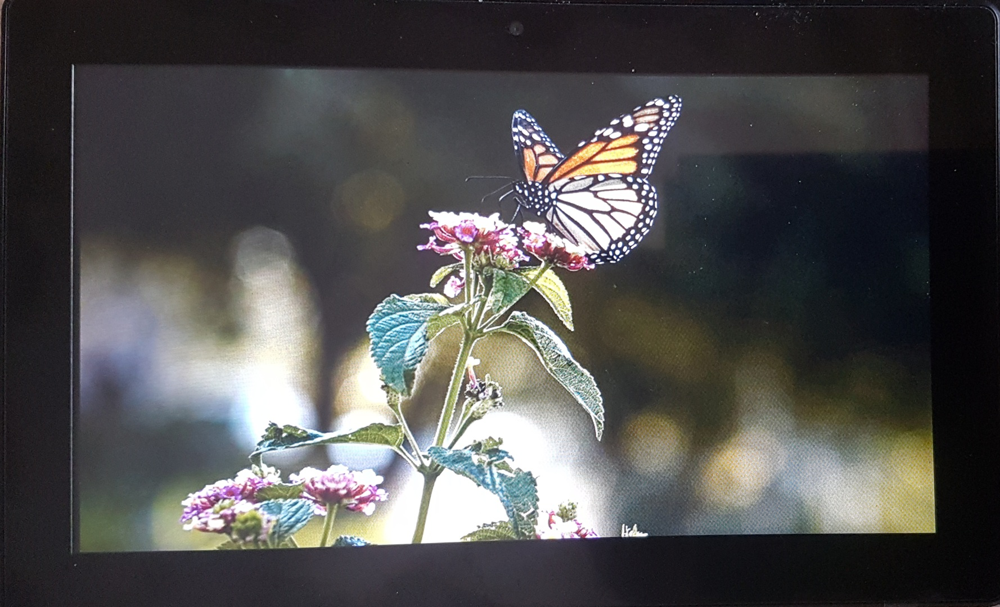 
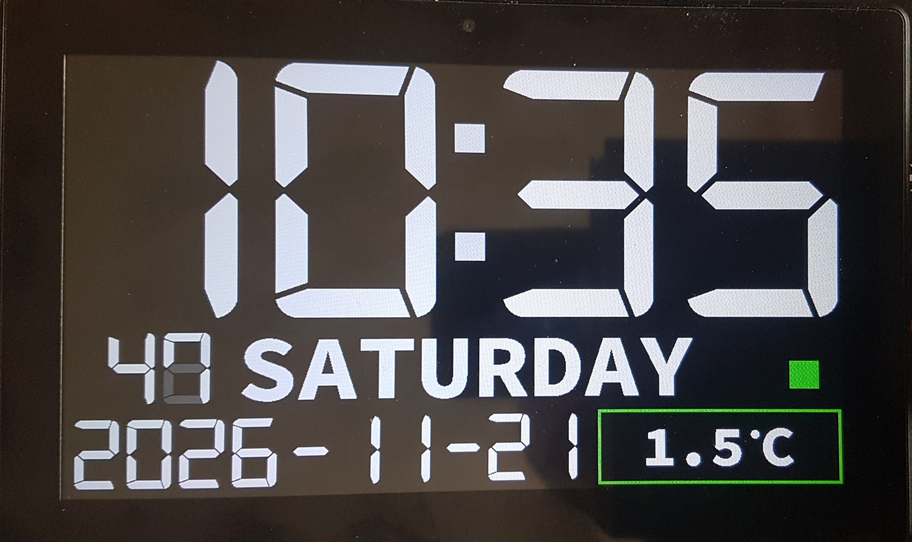 
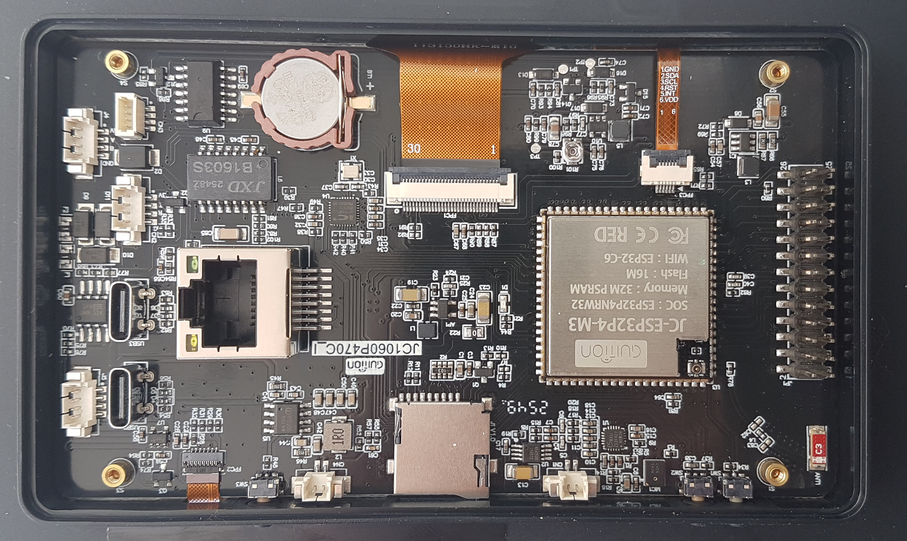 
---
🇬🇧 [English](#-english) | 🇵🇱 [Polski](#-polski)
---
## 🇬🇧 English

> **⚠️ Note – LCD Panel V2 Revision (`panel-v2`)**
> This branch is dedicated to the newer hardware revision of the 7" display (`JC1060P470C_I_W_Y`, 1024×600). It retains the same **JD9165** driver IC, but uses an updated initialization sequence (58 commands extracted from stock Brookesia v2.0.2 firmware) and adjusted DPI timings (`51 MHz`, HSYNC: `24/136/160`, VSYNC: `2/21/12`).
> *For the older panel revision (V1), please use the `master` / `main` branch.*

Bare-metal **ESP-IDF** starter project for the **Guition JC1060P470C_I_W_Y** development board featuring a 7.0" (1024×600) MIPI-DSI display and a GT911 capacitive touch controller.

> ⚠️ **WARNING – ESP32-P4 Silicon Revision (v1.3 / ECO2):**
> This board uses the **ESP32-P4 rev. v1.3 (ECO2)** chip. Be very careful when modifying `sdkconfig` / `sdkconfig.defaults` – do not overwrite the silicon revision settings, 32 MB PSRAM configuration...

#### ⚙️ Build Optimization Recommendations

* **Compiler Optimization (`-O2`):** This project is configured and built with full performance optimization (**`-O2`**, `CONFIG_COMPILER_OPTIMIZATION_PERF=y` in `sdkconfig.defaults`). Any earlier flickering or visual artifacts under `-O2` have been completely eliminated thanks to full hardware-synchronized **double buffering** (`flush_screen_vsync`).
* **ESP-IDF Version (`v5.5.3`):** This firmware was developed, compiled, and verified exclusively using **ESP-IDF v5.5.3**. Due to rapid changes in MIPI-DSI, PSRAM, and `esp_hosted` drivers across framework releases, there is no guarantee that compiling with any other ESP-IDF version will succeed without modifications.
 
### 📊 Project Status (Milestones)

- [x] **Milestone 1:** MIPI-DSI bus wake-up, LDO3 power, PWM backlight, and **JD9165** driver initialisation (clean ~60 Hz output with zero DMA errors).
- [ ] **Milestone 2:** **GT911** touch controller integration on the shared I2C bus.
- [ ] **Milestone 3:** Hardware RTC setup and UI rendering (`stb_truetype`) in native 1024×600 landscape mode.

### ⚙️ Key Hardware & MIPI-DSI Parameters

| Parameter | Value | Notes |
| :--- | :--- | :--- |
| **Microcontroller** | ESP32-P4 (rev. v1.3 / ECO2) | 32 MB PSRAM, 16 MB Flash |
| **Co-processor** | ESP32-C6 | Wi-Fi 6 (2.4 GHz) / BLE over SDIO |
| **LCD Driver** | JD9165 (MIPI-DSI, 2 lanes) | 750 Mbps per lane (`lane_bit_rate_mbps = 750`) |
| **Resolution** | 1024 × 600 (Landscape) | Native landscape orientation (no PPA rotation needed) |
| **Refresh Rate / Pixel Clock** | ~60 Hz (59.11 Hz) / **52 MHz** | `H_total = 1364`, `V_total = 645` |
| **MIPI D-PHY Power** | Internal LDO Channel 3 | `2500 mV` |

### 📌 Verified Pinout (`pins_config.h`)

* **`LCD_RST`:** `GPIO_NUM_0` *(Strapping pin – do not hold low during boot; may require pressing the on-board RESET button after flashing).*
* **`LCD_LED` (PWM Backlight):** `GPIO_NUM_23`
* **`I2C_SDA` / `I2C_SCL`:** `GPIO_NUM_7` / `GPIO_NUM_8` *(Shared I2C bus for the GT911 touch controller and hardware RTC).*
* **`TOUCH_INT` / `TOUCH_RST`:** `GPIO_NUM_21` / `GPIO_NUM_22`

## Key Features

* **High-Speed MIPI-DSI Display & Hardware VSYNC:** Smooth, tear-free rendering driven by the ESP32-P4 MIPI-DSI interface with VSYNC semaphore synchronization and DMA cache management (`esp_cache_msync`).
* **Real-Time 3D Vector Dots Engine:** Interactive 3D wireframe/point-cloud sphere animation (`vectordotsball`) rendered smoothly on the MIPI-DSI framebuffer.
* **Dynamic TrueType Font Rendering:** Crisp, anti-aliased vector typography (`stb_truetype`) rendered dynamically at arbitrary font sizes across the clock face and settings screens.
* **Built-in SoftAP & HTTP Wi-Fi Setup Portal:** Zero-hardcode Wi-Fi configuration via an embedded HTTP server (`http://192.168.4.1`). Tap **WiFi** in the touch menu, connect to **`ESP32-CLOCK-SETUP`** from any phone or PC, and save credentials directly to SPIFFS (`/spiffs/prefs.ini`).
* **Automatic NTP Time Synchronization:** Non-blocking background time sync via the onboard ESP32-C6 co-processor (`esp_wifi_remote` / `esp_hosted` over SDIO) with automatic CET/CEST daylight saving time support.
* **Software JPEG Decoding & PWM Backlight Control:** Built-in support for `esp_new_jpeg` graphics decoding, GT911 capacitive touch input, and smooth PWM backlight dimming/wake-up.
* **SPIFFS Resource Management (`FOTOS`):** Dedicated SPIFFS storage for slideshow images (`FOTO1.jpg`, `FOTO2.jpg`), Wi-Fi credentials (`prefs.ini`), and weather location coordinates (`weather.ini`). Detailed setup instructions are available in the [FOTOS/README.md](FOTOS/README.md) file.
* **Test PAINT Application:** Added a built-in test **PAINT** drawing application to showcase touch responsiveness and smooth rendering on the display.

---
## 🇵🇱 Polski

> **⚠️ Uwaga – Wersja dla panelu LCD V2 (`panel-v2`)**
> Ten branch jest przeznaczony dla nowszej rewizji wyświetlacza 7" (`JC1060P470C_I_W_Y`, 1024×600). Zachowano ten sam układ sterownika **JD9165**, ale zastosowano zaktualizowaną sekwencję inicjalizacyjną (58 komend z firmware fabrycznego Brookesia v2.0.2) oraz zmienione timingi magistrali DPI (`51 MHz`, HSYNC: `24/136/160`, VSYNC: `2/21/12`).
> *Dla starszej rewizji matrycy (V1) użyj brancha `master` / `main`.*

---

Projekt bazowy w czystym **ESP-IDF** dla płytki rozwojowej **Guition JC1060P470C_I_W_Y** z wyświetlaczem 7.0" (1024×600) oraz panelem dotykowym GT911.

> ⚠️ **UWAGA – Rewizja krzemu ESP32-P4 (v1.3 / ECO2):**
> Płytka wyposażona jest w układ **ESP32-P4 w rewizji v1.3 (ECO2)**. Należy zachować szczególną ostrożność przy modyfikacji pliku `sdkconfig` / `sdkconfig.defaults` – nie nadpisywać ustawień rewizji układu...

#### ⚙️ Zalecenia dotyczące optymalizacji kompilacji
* **Optymalizacja kompilatora (`-O2`):** Projekt jest skonfigurowany i budowany z pełną optymalizacją wydajności (**`-O2`**, `CONFIG_COMPILER_OPTIMIZATION_PERF=y` w `sdkconfig.defaults`). Wcześniejszy flickering oraz artefakty obrazu występujące przy `-O2` zostały całkowicie wyeliminowane dzięki pełnemu **podwójnemu buforowaniu (double buffering)** zsynchronizowanemu z VSYNC.
* **Wersja ESP-IDF (`v5.5.3`):** Ten program został napisany, skompilowany i przetestowany wyłącznie w wersji **ESP-IDF v5.5.3**. Ze względu na częste zmiany w sterownikach MIPI-DSI, PSRAM oraz `esp_hosted` między wydaniami frameworka, nie ma żadnej gwarancji, że użycie jakiejkolwiek innej wersji ESP-IDF pozwoli na poprawne zbudowanie projektu.

### 📊 Status projektu (Kamienie milowe)

- [x] **Milestone 1:** Wybudzenie magistrali MIPI-DSI, zasilania LDO3, podświetlenia PWM oraz sterownika **JD9165** (czysty obraz ~60 Hz bez błędów DMA).
- [ ] **Milestone 2:** Integracja panelu dotykowego **GT911** na współdzielonej szynie I2C.
- [ ] **Milestone 3:** Uruchomienie sprzętowego zegara RTC i renderowanie UI (`stb_truetype`) w natywnym układzie poziomym 1024×600.

### ⚙️ Kluczowe parametry sprzętowe i MIPI-DSI

| Parametr | Wartość | Uwagi |
| :--- | :--- | :--- |
| **Mikrokontroler** | ESP32-P4 (rev. v1.3 / ECO2) | 32 MB PSRAM, 16 MB Flash |
| **Koprocesor** | ESP32-C6 | Wi-Fi 6 (2.4 GHz) / BLE po SDIO |
| **Sterownik LCD** | JD9165 (MIPI-DSI, 2 linie) | 750 Mbps na linię (`lane_bit_rate_mbps = 750`) |
| **Rozdzielczość** | 1024 × 600 (Landscape) | Natywna orientacja pozioma (bez obrotu PPA) |
| **Odświeżanie / Pixel Clock** | ~60 Hz (59.11 Hz) / **52 MHz** | `H_total = 1364`, `V_total = 645` |
| **Zasilanie MIPI D-PHY** | Wewnętrzne LDO Kanał 3 | `2500 mV` |

### 📌 Zweryfikowany Pinout (`pins_config.h`)

* **`LCD_RST`:** `GPIO_NUM_0` *(Pin strappingowy – nie wymuszać stanu niskiego podczas bootowania; po flashowaniu może wymagać naciśnięcia przycisku RESET na płytce).*
* **`LCD_LED` (Podświetlenie PWM):** `GPIO_NUM_23`
* **`I2C_SDA` / `I2C_SCL`:** `GPIO_NUM_7` / `GPIO_NUM_8` *(Współdzielona magistrala dla dotyku GT911 oraz układu RTC).*
* **`TOUCH_INT` / `TOUCH_RST`:** `GPIO_NUM_21` / `GPIO_NUM_22`

---
## Główne funkcje (Key Features)

* **Szybki wyświetlacz MIPI-DSI i sprzętowy VSYNC:** Płynne renderowanie obrazu bez efektu rozrywania klatek (tearingu) przez interfejs MIPI-DSI układu ESP32-P4 z synchronizacją semaforem VSYNC i zarządzaniem pamięcią podręczną DMA (`esp_cache_msync`).
* **Silnik 3D Vector Dots w czasie rzeczywistym:** Płynna animacja obracającej się sfery 3D złożonej z punktów wektorowych (`vectordotsball`) renderowana bezpośrednio w buforze ramki MIPI-DSI.
* **Dynamiczne renderowanie czcionek TrueType:** Ostra, wygładzana typografia wektorowa (`stb_truetype`) generowana w locie w dowolnym rozmiarze na tarczy zegara oraz w ekranach ustawień.
* **Wbudowany portal konfiguracyjny SoftAP i serwer HTTP:** Konfiguracja Wi-Fi bez wpisywania haseł w kodzie źródłowym, przez wbudowany serwer WWW (`http://192.168.4.1`). Wystarczy dotknąć **WiFi** w menu, połączyć się z siecią **`ESP32-CLOCK-SETUP`** z telefonu lub komputera i zapisać dane w pamięci SPIFFS (`/spiffs/prefs.ini`).
* **Automatyczna synchronizacja czasu NTP:** Pobieranie aktualnego czasu w tle przez koprocesor ESP32-C6 (`esp_wifi_remote` / `esp_hosted` po SDIO) z automatyczną obsługą zmiany czasu letniego i zimowego (CET/CEST).
* **Programowe dekodowanie JPEG i sterowanie podświetleniem PWM:** Obsługa dekodera `esp_new_jpeg`, pojemnościowego panelu dotykowego GT911 oraz wygaszania i wybudzania podświetlenia ekranu przez PWM.
* **Zarządzanie zasobami SPIFFS (`FOTOS`):** Dedykowana partycja SPIFFS przechowująca zdjęcia pokazu slajdów (`FOTO1.jpg`, `FOTO2.jpg`), dane sieci Wi-Fi (`prefs.ini`) oraz współrzędne lokalizacji dla pogody (`weather.ini`). Szczegółowa instrukcja konfiguracji znajduje się w pliku [FOTOS/README.md](FOTOS/README.md).
* **Testowa aplikacja PAINT:** Dodano wbudowaną testową aplikację do rysowania **PAINT**, demonstrującą responsywność ekranu dotykowego oraz płynność renderowania obrazu.

---
 
 
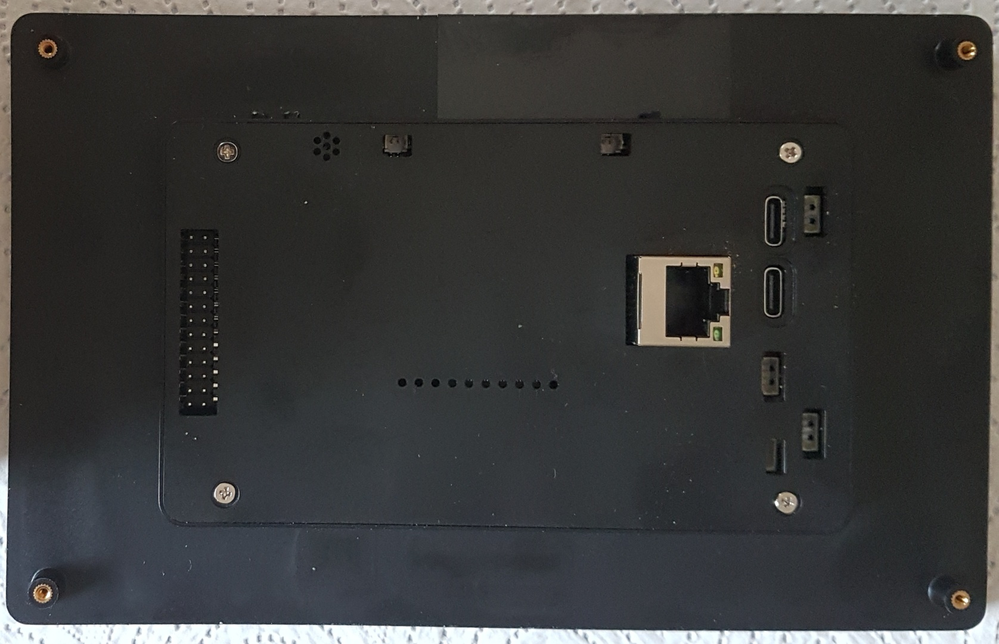 
 
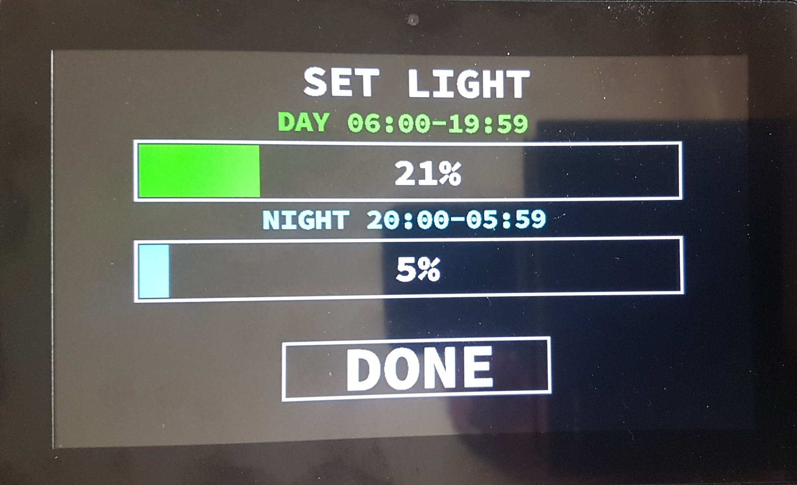 
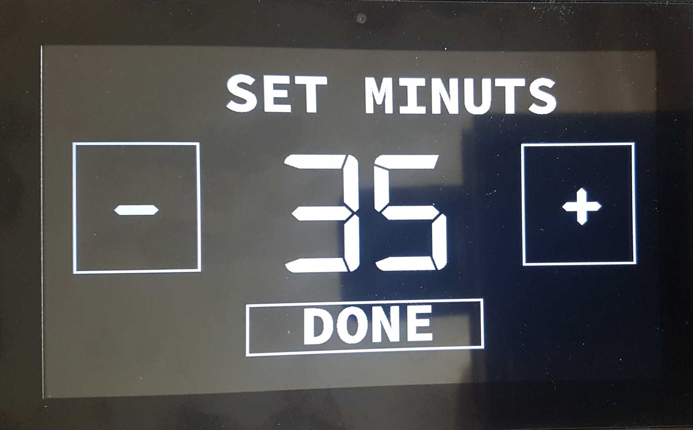 
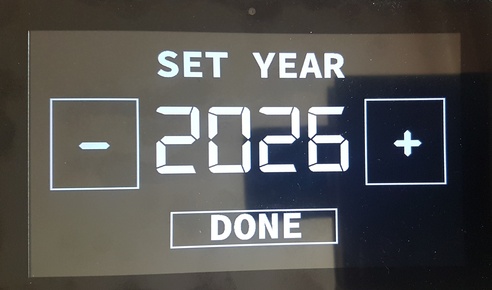 
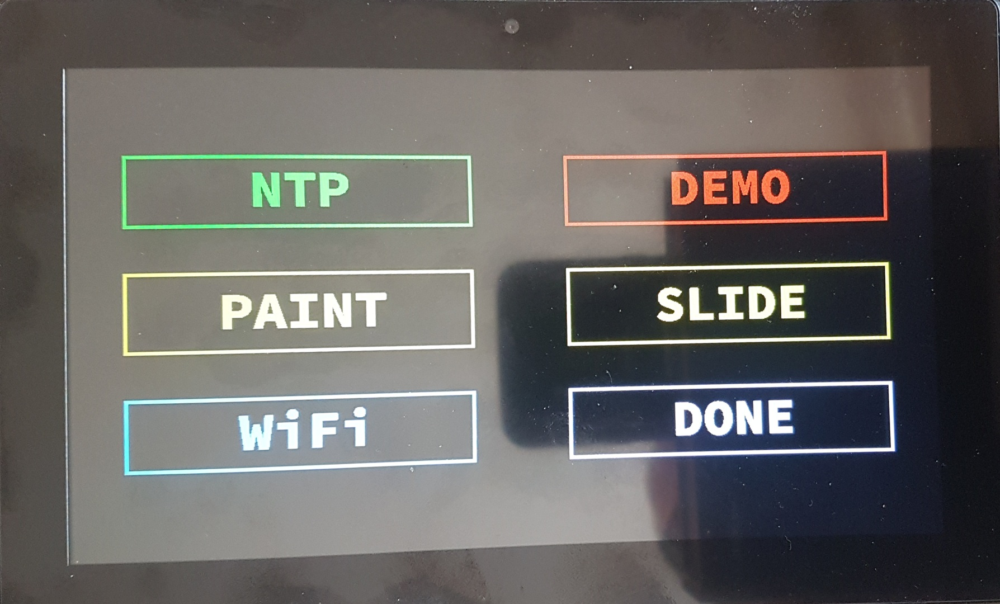 
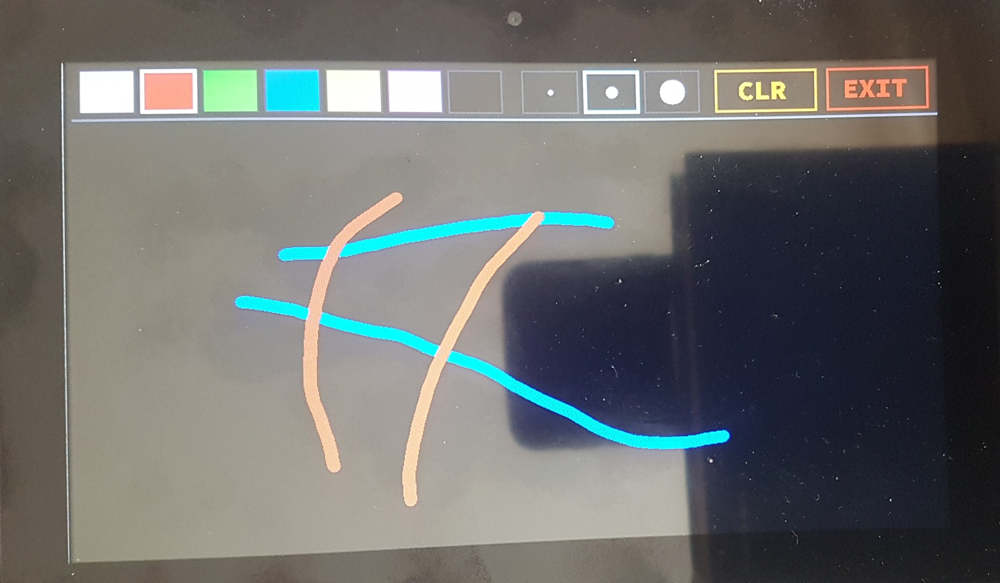 
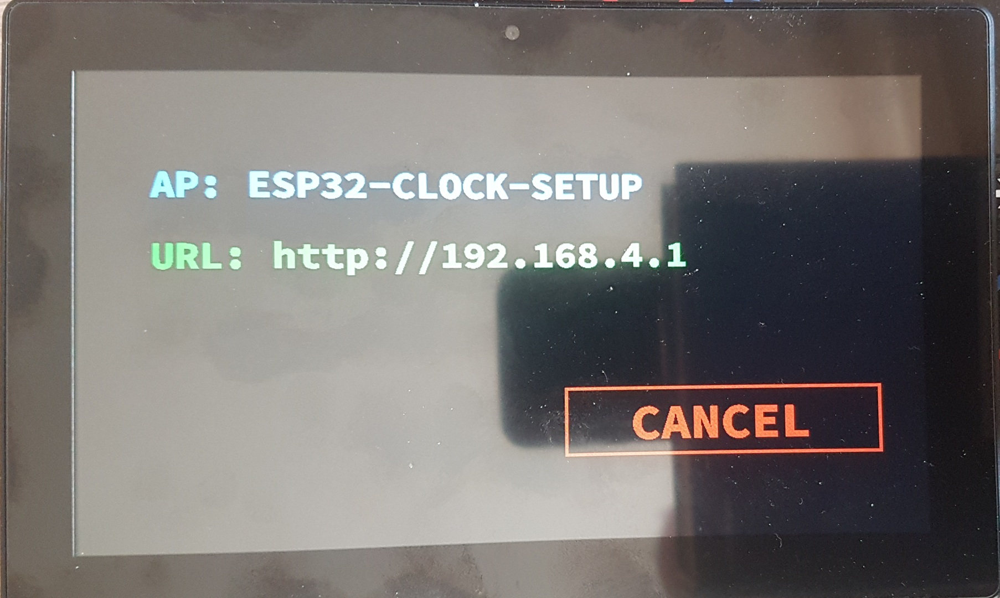 
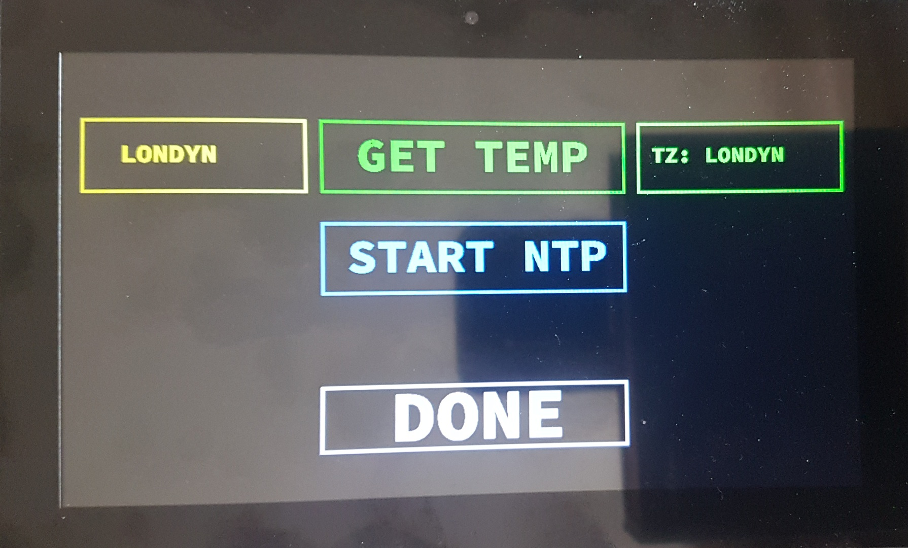 
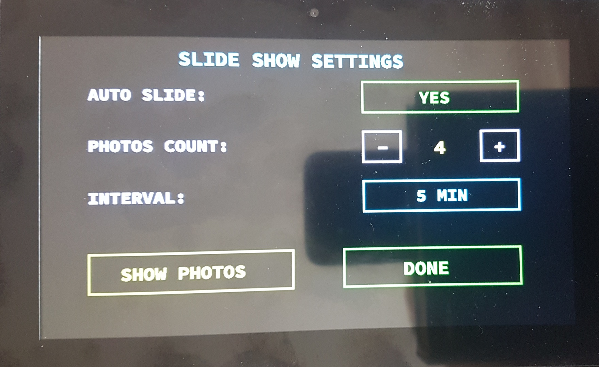 
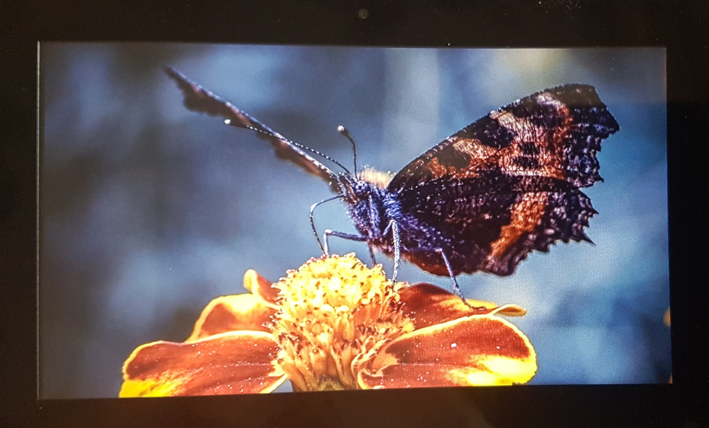 
 
# ---
